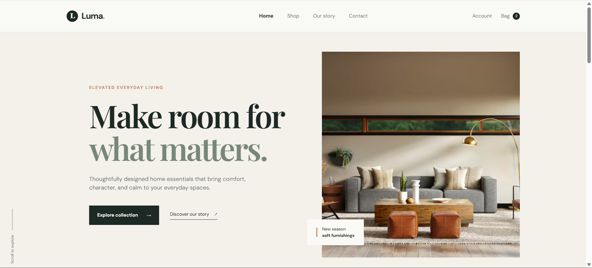

# Ex02 Commercial Website
## Date:02/11/2026

## AIM
To create a commercial website using CSS Flexbox.

## ALGORITHM
### STEP 1
Create an HTML file (index.html)

### STEP 2
Create a CSS file (style.css)

### STEP 3
Include a navigation bar with links to different sections.

### STEP 4
Add structured sections for Homepage, Products / Services, About Us, Contact Details and User Account.

### STEP 5
Include social media links at the footer with copyright information.

### STEP 6
Define global styles for fonts, colors, and layout.

### STEP 7
Style the header, navigation bar, and sections.

### STEP 8
Use Flexbox for layout design.

### STEP 9
Add hover effects and transitions for interactivity.

### STEP 10
Add Images and Media.

### STEP 11
Use optimized images for a professional look.

### STEP 12
Open the HTML file in a browser to check layout and functionality.

### STEP 13
Fix styling issues and refine content placement.

### STEP 14
Deploy the website.

### STEP 15
Upload to GitHub Pages for free hosting.

## PROGRAM
HTML:
```
<!DOCTYPE html>
<html lang="en">
<head>
  <meta charset="UTF-8">
  <meta name="viewport" content="width=device-width, initial-scale=1.0">
  <meta name="description" content="Luma Living - thoughtfully designed essentials for modern homes.">
  <title>Luma Living | Modern essentials for everyday life</title>
  <link rel="preconnect" href="https://fonts.googleapis.com">
  <link rel="preconnect" href="https://fonts.gstatic.com" crossorigin>
  <link href="https://fonts.googleapis.com/css2?family=DM+Sans:wght@400;500;600;700&family=Playfair+Display:wght@600;700&display=swap" rel="stylesheet">
  <link rel="stylesheet" href="style.css">
</head>
<body>
  <header class="site-header">
    <div class="container nav-wrapper">
      <a class="brand" href="#home" aria-label="Luma Living home">
        <span class="brand-mark">L</span>
        <span>Luma<span class="brand-accent">.</span></span>
      </a>
      <nav class="main-nav" aria-label="Main navigation">
        <a class="active" href="#home">Home</a>
        <a href="#products">Shop</a>
        <a href="#about">Our story</a>
        <a href="#contact">Contact</a>
      </nav>
      <div class="nav-actions">
        <a href="#account" aria-label="Open account">Account</a>
        <a href="#cart" class="cart-link" aria-label="Shopping bag with 2 items">
          Bag <span class="cart-count">2</span>
        </a>
      </div>
    </div>
  </header>

  <main>
    <section id="home" class="hero">
      <div class="container hero-content">
        <div class="hero-copy">
          <p class="eyebrow">Elevated everyday living</p>
          <h1>Make room for<br><em>what matters.</em></h1>
          <p class="hero-text">Thoughtfully designed home essentials that bring comfort, character, and calm to your everyday spaces.</p>
          <div class="hero-actions">
            <a class="button button-dark" href="#products">Explore collection <span>→</span></a>
            <a class="text-link" href="#about">Discover our story <span>↗</span></a>
          </div>
        </div>
        <div class="hero-visual">
          <div class="hero-image">
            
          </div>
          <div class="floating-note">
            <span class="note-line"></span>
            <span>New season<br><strong>soft furnishings</strong></span>
          </div>
        </div>
      </div>
      <div class="hero-scroll"><span>Scroll to explore</span><span class="scroll-line"></span></div>
    </section>

    <section id="products" class="section products-section">
      <div class="container">
        <div class="section-heading">
          <div>
            <p class="eyebrow">Curated for you</p>
            <h2>Small details.<br><em>Big difference.</em></h2>
          </div>
          <a class="text-link" href="#products">View all products <span>↗</span></a>
        </div>
        <div class="product-grid">
          <article class="product-card">
            <div class="product-image image-one">
              <span class="product-tag">Bestseller</span>
              <button class="wishlist" aria-label="Add Cloud throw to wishlist">♡</button>
              
            </div>
            <div class="product-info">
              <div><h3>The Cloud Throw</h3><p>Alpaca blend · Oat</p></div><strong>$128</strong>
            </div>
          </article>
          <article class="product-card">
            <div class="product-image image-two">
              <button class="wishlist" aria-label="Add Forma vase to wishlist">♡</button>
              
            </div>
            <div class="product-info">
              <div><h3>Forma Vase</h3><p>Hand-thrown ceramic · Sand</p></div><strong>$74</strong>
            </div>
          </article>
          <article class="product-card">
            <div class="product-image image-three">
              <span class="product-tag">New</span>
              <button class="wishlist" aria-label="Add Serein candle to wishlist">♡</button>
              
            </div>
            <div class="product-info">
              <div><h3>Serein Candle</h3><p>Soy wax · Cedar & fig</p></div><strong>$42</strong>
            </div>
          </article>
        </div>
      </div>
    </section>

    <section id="about" class="story-section">
      <div class="container story-grid">
        <div class="story-image">
          
          <span class="image-caption">Designed with intention</span>
        </div>
        <div class="story-copy">
          <p class="eyebrow">The Luma philosophy</p>
          <h2>Good design should feel <em>like home.</em></h2>
          <p>We believe the things you live with should be as considered as the way you live. Luma brings together honest materials, timeless forms, and the makers behind them.</p>
          <p>From the first sketch to the final stitch, every detail is made to last — and to make your everyday a little more beautiful.</p>
          <a class="text-link" href="#contact">Meet the makers <span>↗</span></a>
        </div>
      </div>
    </section>

    <section id="contact" class="newsletter-section">
      <div class="container newsletter-inner">
        <div><p class="eyebrow">Stay in the know</p><h2>Notes from Luma.</h2></div>
        <form class="newsletter-form">
          <label class="sr-only" for="email">Email address</label>
          <input id="email" type="email" placeholder="Your email address" required>
          <button type="submit" class="button button-light">Sign me up <span>→</span></button>
        </form>
      </div>
    </section>

    <section id="account" class="account-section">
      <div class="container account-inner">
        <div><p class="eyebrow">Your Luma account</p><h2>Keep your favorites<br><em>close at hand.</em></h2></div>
        <a class="button button-dark" href="#account">Sign in <span>→</span></a>
      </div>
    </section>
  </main>

  <footer class="site-footer">
    <div class="container footer-top">
      <div class="footer-brand"><a class="brand" href="#home"><span class="brand-mark">L</span><span>Luma<span class="brand-accent">.</span></span></a><p>Thoughtful objects<br>for everyday living.</p></div>
      <div class="footer-links"><div><h3>Explore</h3><a href="#products">Shop all</a><a href="#about">Our story</a><a href="#contact">Journal</a></div><div><h3>Help</h3><a href="#contact">Contact us</a><a href="#contact">Shipping & returns</a><a href="#contact">FAQ</a></div><div><h3>Follow along</h3><a href="https://www.instagram.com/" target="_blank" rel="noreferrer">Instagram ↗</a><a href="https://www.pinterest.com/" target="_blank" rel="noreferrer">Pinterest ↗</a><a href="https://www.facebook.com/" target="_blank" rel="noreferrer">Facebook ↗</a></div></div>
    </div>
    <div class="container footer-bottom"><span>© 2024 Luma Living. All rights reserved.</span><span>Made with intention.</span></div>
  </footer>
</body>
</html>
```

CSS:
```
:root {
  --ink: #1d2925;
  --muted: #6d756f;
  --cream: #f4f1eb;
  --sand: #dfd6c8;
  --sage: #b7c3b4;
  --line: #d7d7d0;
  --accent: #c57d55;
}

* { box-sizing: border-box; margin: 0; padding: 0; }
html { scroll-behavior: smooth; }
body { background: #faf9f6; color: var(--ink); font-family: "DM Sans", sans-serif; line-height: 1.5; }
a { color: inherit; text-decoration: none; }
img { display: block; height: 100%; object-fit: cover; width: 100%; }
.container { margin: 0 auto; max-width: 1240px; padding: 0 32px; }
.site-header { background: #faf9f6e8; border-bottom: 1px solid #e8e7e1; position: absolute; top: 0; width: 100%; z-index: 2; }
.nav-wrapper { align-items: center; display: flex; height: 82px; justify-content: space-between; }
.brand { align-items: center; display: inline-flex; font-size: 22px; font-weight: 700; gap: 9px; letter-spacing: -.05em; }
.brand-mark { align-items: center; background: var(--ink); border-radius: 50%; color: #fff; display: inline-flex; font-family: Georgia, serif; font-size: 18px; height: 30px; justify-content: center; width: 30px; }
.brand-accent { color: var(--accent); }
.main-nav { display: flex; gap: 36px; margin-left: 130px; }
.main-nav a, .nav-actions a { color: var(--muted); font-size: 13px; transition: color .25s ease; }
.main-nav a:hover, .nav-actions a:hover, .main-nav .active { color: var(--ink); }
.main-nav .active { font-weight: 700; }
.nav-actions { align-items: center; display: flex; gap: 24px; }
.cart-link { align-items: center; display: flex; gap: 8px; }
.cart-count { align-items: center; background: var(--ink); border-radius: 50%; color: #fff; display: inline-flex; font-size: 10px; height: 18px; justify-content: center; width: 18px; }
.hero { background: var(--cream); min-height: 720px; padding-top: 82px; position: relative; }
.hero-content { align-items: center; display: flex; gap: 90px; min-height: 638px; }
.hero-copy { flex: 1; padding-left: 5%; }
.eyebrow { color: var(--accent); font-size: 11px; font-weight: 700; letter-spacing: .16em; margin-bottom: 22px; text-transform: uppercase; }
h1, h2 { font-family: "Playfair Display", Georgia, serif; font-weight: 600; letter-spacing: -.045em; line-height: 1.03; }
h1 { font-size: clamp(52px, 6vw, 82px); }
h2 { font-size: clamp(40px, 4vw, 58px); }
em { color: #788877; font-style: normal; }
.hero-text { color: var(--muted); font-size: 15px; margin: 28px 0 35px; max-width: 410px; }
.hero-actions { align-items: center; display: flex; gap: 28px; }
.button { border: 0; cursor: pointer; display: inline-flex; font-size: 12px; font-weight: 700; gap: 22px; justify-content: center; padding: 16px 21px; transition: transform .25s, background .25s; }
.button:hover { transform: translateY(-2px); }
.button-dark { background: var(--ink); color: #fff; }
.button-dark:hover { background: #394840; }
.button-light { background: #f5f2eb; color: var(--ink); }
.text-link { border-bottom: 1px solid currentColor; display: inline-flex; font-size: 12px; gap: 13px; padding-bottom: 5px; }
.hero-visual { flex: 1; max-width: 550px; position: relative; }
.hero-image { height: 535px; overflow: hidden; }
.hero-image img { transition: transform .7s ease; }
.hero-image:hover img { transform: scale(1.04); }
.floating-note { align-items: center; background: #faf9f6; bottom: 32px; display: flex; font-size: 11px; gap: 13px; left: -38px; padding: 17px 24px; position: absolute; }
.floating-note strong { font-weight: 700; }
.note-line { background: var(--accent); height: 24px; width: 2px; }
.hero-scroll { align-items: center; bottom: 28px; color: var(--muted); display: flex; font-size: 10px; gap: 12px; left: 32px; position: absolute; transform: rotate(-90deg); transform-origin: left center; }
.scroll-line { background: var(--muted); height: 1px; width: 55px; }
.section { padding: 125px 0; }
.section-heading { align-items: end; display: flex; justify-content: space-between; margin-bottom: 54px; }
.section-heading .eyebrow { margin-bottom: 18px; }
.section-heading .text-link { margin-bottom: 6px; }
.product-grid { display: flex; gap: 22px; }
.product-card { flex: 1; }
.product-image { background: var(--sand); height: 390px; overflow: hidden; position: relative; }
.product-image img { mix-blend-mode: multiply; transition: transform .5s ease; }
.product-image:hover img { transform: scale(1.05); }
.image-two { background: #dbd3c7; }.image-three { background: #c9c4b8; }
.product-tag { background: #faf9f6; font-size: 10px; left: 18px; padding: 7px 10px; position: absolute; top: 18px; z-index: 1; }
.wishlist { background: #faf9f6; border: 0; border-radius: 50%; cursor: pointer; font-size: 20px; height: 32px; line-height: 1; position: absolute; right: 16px; top: 16px; width: 32px; z-index: 1; }
.product-info { align-items: start; display: flex; justify-content: space-between; padding-top: 17px; }
.product-info h3 { font-size: 14px; font-weight: 600; margin-bottom: 4px; }
.product-info p { color: var(--muted); font-size: 11px; }
.product-info strong { font-size: 13px; font-weight: 500; }
.story-section { background: var(--sage); padding: 120px 0; }
.story-grid { align-items: center; display: flex; gap: 12%; }
.story-image { flex: 1.05; height: 510px; position: relative; }
.image-caption { bottom: 18px; color: #fff; font-size: 10px; left: 20px; letter-spacing: .08em; position: absolute; text-transform: uppercase; }
.story-copy { flex: .9; max-width: 430px; }
.story-copy .eyebrow { color: var(--ink); }
.story-copy h2 { margin-bottom: 28px; }
.story-copy p:not(.eyebrow) { color: #4e5e52; font-size: 14px; margin-bottom: 16px; }
.story-copy .text-link { margin-top: 24px; }
.newsletter-section { background: var(--ink); color: #fff; padding: 72px 0; }
.newsletter-inner { align-items: center; display: flex; justify-content: space-between; }
.newsletter-section .eyebrow { color: #d79a77; margin-bottom: 13px; }
.newsletter-section h2 { font-size: 42px; }
.newsletter-form { display: flex; gap: 10px; }
.newsletter-form input { background: transparent; border: 0; border-bottom: 1px solid #718076; color: #fff; font-family: inherit; font-size: 13px; min-width: 260px; outline: 0; padding: 15px 3px; }
.newsletter-form input::placeholder { color: #a4afa8; }
.account-section { background: var(--cream); padding: 75px 0; }
.account-inner { align-items: center; display: flex; justify-content: space-between; }
.account-section .eyebrow { margin-bottom: 15px; }
.account-section h2 { font-size: 42px; }
.site-footer { background: #f0ede6; padding: 70px 0 25px; }
.footer-top { display: flex; justify-content: space-between; padding-bottom: 70px; }
.footer-brand p { color: var(--muted); font-size: 12px; margin-top: 22px; }
.footer-links { display: flex; gap: 85px; }
.footer-links div { display: flex; flex-direction: column; gap: 9px; }
.footer-links h3 { font-size: 11px; margin-bottom: 10px; text-transform: uppercase; }
.footer-links a { color: var(--muted); font-size: 12px; }
.footer-links a:hover { color: var(--ink); }
.footer-bottom { border-top: 1px solid var(--line); color: var(--muted); display: flex; font-size: 10px; justify-content: space-between; padding-top: 20px; }
.sr-only { height: 1px; margin: -1px; overflow: hidden; position: absolute; width: 1px; clip: rect(0, 0, 0, 0); }
@media (max-width: 800px) {
  .main-nav { gap: 15px; margin-left: 0; }
  .nav-actions a:first-child { display: none; }
  .hero-content, .story-grid { flex-direction: column; gap: 45px; padding-bottom: 70px; padding-top: 55px; }
  .hero { min-height: auto; }.hero-copy { padding-left: 0; }.hero-visual { max-width: 100%; width: 100%; }
  .hero-image { height: 430px; }.hero-scroll { display: none; }
  .section { padding: 85px 0; }.product-grid { flex-wrap: wrap; }.product-card { min-width: calc(50% - 11px); }.product-image { height: 300px; }
  .story-image { height: 400px; width: 100%; }.story-copy { max-width: none; }
  .newsletter-inner, .account-inner { align-items: start; flex-direction: column; gap: 30px; }
  .footer-top { gap: 45px; flex-direction: column; }.footer-links { gap: 35px; justify-content: space-between; }
}
@media (max-width: 520px) {
  .container { padding: 0 20px; }.main-nav { display: none; }.nav-wrapper { height: 70px; }
  .hero { padding-top: 70px; }.hero-content { min-height: 0; padding-bottom: 65px; }.hero-image { height: 360px; }
  .floating-note { bottom: 18px; left: 15px; }.hero-actions { align-items: start; flex-direction: column; gap: 20px; }
  .section-heading { align-items: start; flex-direction: column; gap: 28px; }.product-card { min-width: 100%; }.product-image { height: 360px; }
  .newsletter-form { align-items: stretch; flex-direction: column; width: 100%; }.newsletter-form input { min-width: 0; }.newsletter-form .button { width: 100%; }
  .footer-links { flex-wrap: wrap; }.footer-bottom { gap: 12px; flex-direction: column; }
}

```


## OUTPUT


## RESULT
The program for creating commercial website using CSS Flexbox is executed successfully.